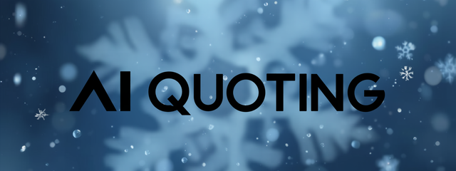
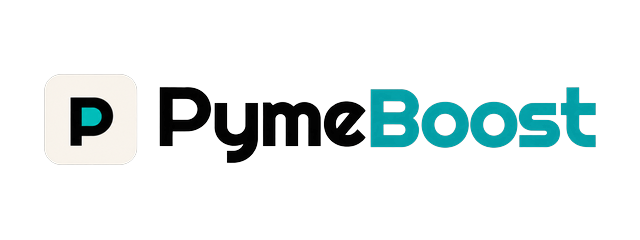
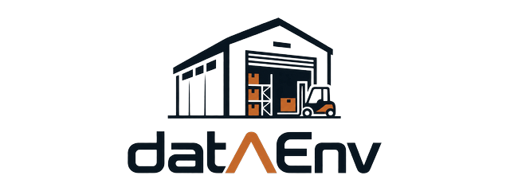
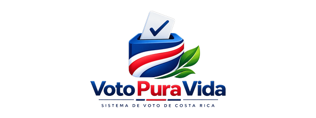

  

<h1>
 
Isaac Villalobos Bonilla
</h1>

**Computer Engineering @ [TEC](https://www.tec.ac.cr/)**

I build backend, data and cloud systems, yeah I know, really original.

 

I shipped an Azure-native quoting platform for industrial cooling systems as its sole developer: infrastructure as code, identity-based auth with zero stored secrets, and a RAG agent that keeps every inference inside the client's own tenant. Before that I built the AI matching layer of a platform that ranks business advisors by embeddings over a pgvector index.

 

## Experience

<table>
<tr>
<td width="50%" valign="top" align="center">
  
    
  <strong>AI Quoting Platform</strong>
    
  Internal platform for pricing and configuring industrial cooling systems. Its core is a <strong>RAG quoting agent on Azure AI Foundry</strong>: a deployed chat model grounded in the client's own knowledge base served from Dataverse, with retrieval and inference kept entirely in-tenant so no client data ever leaves their subscription. Around it I worked the whole Azure footprint as modular Bicep, the multi-stage Azure DevOps pipelines, and the migration to Managed Identity and workload identity federation that removed every stored credential.
    
  
  
  
  
  
  
  
  
    
  
</td>

<td width="50%" valign="top" align="center">
  
    
  <strong>PymeBoost</strong>
    
  Platform matching Costa Rican SMEs with vetted business advisors. I structured the FastAPI backend around Domain-Driven Design and vertical slices, moved the system onto a Pub/Sub event bus for fault-tolerant workflows with a real audit trail, and built the matching layer with LangGraph over a pgvector index. Onboarding validates legal documents via OCR against the official MEIC registry.
    
  
  
  
  
  
    
  
  
</td>
</tr>

<tr>
<td width="50%" valign="top" align="center">
  
    
  <strong>Data Environment</strong>
    
  End-to-end data platform that folds five heterogeneous databases (PostgreSQL, SQL Server, MySQL, MongoDB and Neo4j) into one analytical ecosystem. Modular Python ETL pipelines extract, de-duplicate and reconcile SKU equivalences across sources into a star-schema warehouse, and an Apriori engine mines cross-sell rules surfaced through React and Power BI.
    
  
  
  
  
  
    
  
</td>

<td width="50%" valign="top" align="center">
  
    
  <strong>Voto Pura Vida</strong>
    
  Electronic voting and crowdfunding platform for Costa Rica, on Node.js/Express over SQL Server, exposing REST endpoints for voting, proposals, investments and dividend distribution. Hardened with multi-factor authentication, AES-256/RSA encryption and full audit-trail logging; business logic lives in both Prisma and native stored procedures, with schema evolution under versioned Flyway migrations.
    
  
  
  
  
  
    
  
</td>
</tr>
</table>

 

## The stuff I actually use

<table>
<tr>
<td valign="middle"><strong>Languages</strong></td>
<td>

</td>
</tr>
<tr>
<td valign="middle"><strong>Cloud &amp; DevOps</strong></td>
<td>

</td>
</tr>
<tr>
<td valign="middle"><strong>Backend</strong></td>
<td>

</td>
</tr>
<tr>
<td valign="middle"><strong>Frontend</strong></td>
<td>

</td>
</tr>
<tr>
<td valign="middle"><strong>Data</strong></td>
<td>

</td>
</tr>
<tr>
<td valign="middle"><strong>AI &amp; ML</strong></td>
<td>

</td>
</tr>
</table>

**Also in the toolkit:** Domain-Driven Design · event-driven architecture · microservices · REST API design · infrastructure as code · CI/CD · Managed Identity &amp; workload identity federation (OIDC) · Key Vault · Application Insights &amp; Log Analytics · star-schema modeling · query optimization · Agile/Scrum

 

  
Open to internships and new grad roles · <a href="mailto:IsaacVillalobosB@gmail.com">IsaacVillalobosB@gmail.com</a>

